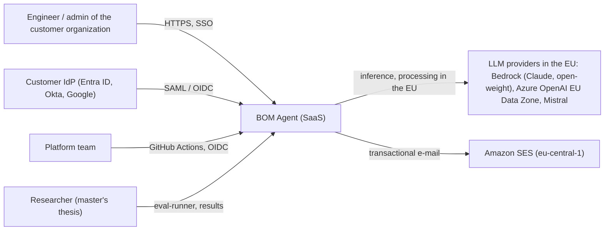
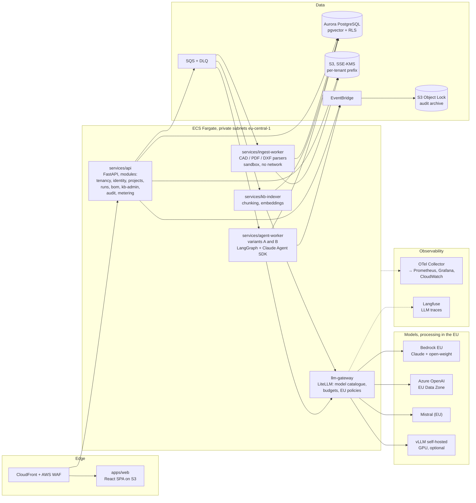

# BOM Agent platform architecture (target, production)

Status: **accepted for implementation** (decision details in `docs/adr/`). Author of the recommendation: Claude, based on Bartek's requirements (2026-11-09).

## 1. Requirements that drive the architecture

| # | Requirement | Architectural consequence |
|---|---|---|
| R1 | Customers are external companies (B2B SaaS), many organizations | multi-tenancy from the first commit, SSO per organization, RBAC, self-service onboarding |
| R2 | Data and processing exclusively in the EU | AWS `eu-central-1`, SCPs blocking non-EU regions, LLM providers with an EU processing guarantee |
| R3 | Closed models (top tier: Anthropic, OpenAI) **and** open models (open-weight), distinguished in experiments | LLM Gateway with a model catalogue and per-tenant routing policies |
| R4 | Shared knowledge base, but isolated spaces; organizations do not learn from each other | global corpus (public, read-only) + per-tenant spaces, RLS, no fine-tuning on customer data |
| R5 | All formats: KiCad, Altium, Cadence (OrCAD/Allegro), PDF, DXF/DWG | pluggable parser layer, isolated ingestion service with heavy dependencies |
| R6 | Modular, not a monolith; microservices only where justified | 4 deployment services + domain libraries with hard boundaries (see §3) |
| R7 | Fast agents | deterministic steps first, parallel fan-out, model tiering, prompt caching, streaming |
| R8 | Observability, monitoring, auditability | OpenTelemetry everywhere, LLM tracing (Langfuse), immutable audit log |
| R9 | E2E tests, smoke tests, everything "legit" | test pyramid + tenant isolation tests + LLM evaluations as regression tests (see `TESTING.md`) |
| R10 | Master's thesis: comparison of A vs B | variants as interchangeable "runtimes" on a shared contract; the experiment is pinned to the model version, prompts, rules and knowledge base snapshot |

## 2. Context view (C4 – level 1)



## 3. Container view (C4 – level 2)


Source: `docs/img/platform-architecture.svg` (generator: `tools/platform_arch.py`). The same view as Mermaid (editable):



### Why exactly these services (and no more)
| Deployment unit | Why separate |
|---|---|
| `api` | Plain CRUD + request orchestration. A **modular service**, not microservices: domain modules have hard boundaries (import-linter, separate table schemas) but share a process – because they share transactions and do not have different scaling profiles. |
| `ingest-worker` | Processes **untrusted files** and has heavy native dependencies (kicad-cli, DWG converters, Docling/OCR). Security isolation + a different resource profile. |
| `agent-worker` | Long tasks (seconds to minutes), scaling by queue length, heavy LLM traffic. A different scaling profile than the API. |
| `kb-indexer` | Batch embeddings of large documents; scales independently, must not block agent runs. |
| `llm-gateway` | A single place to enforce EU policies, per-tenant budgets, logging and fallback between providers. A ready-made component (LiteLLM), we do not write it from scratch. |
| `model-serving` | GPU – different infrastructure (EC2 GPU, Fargate does not support GPUs). Enabled by a flag; by default open-weight via Bedrock. |

The following are **not** microservices: validation rules, format parsers, BOM logic, eval – they are libraries (`packages/py/*`) used by the services. As a result, variants A and B use exactly the same domain code.

## 4. Repository layout (monorepo)

```
apps/web/                      React + Vite + TanStack Router/Query + Tailwind + shadcn/ui
packages/ts/ui/                design system (components based on shadcn/ui, tokens)
packages/ts/api-client/        client generated from OpenAPI
services/api/                  FastAPI, domain modules
services/ingest-worker/
services/agent-worker/
services/kb-indexer/
packages/py/platform-common/   tenant context, auth, OTel, logging, audit emitter, configuration
packages/py/bom-core/          BOM domain model, JSON Schema, unit normalization, grouping
packages/py/cad-parsers/       format plugins (KiCad, Altium, Cadence, IPC-2581, ODB++, EDIF, PDF, DXF/DWG)
packages/py/rules/             deterministic validators, versioned rule packs (e.g. IEC 60601 checklist)
packages/py/kb/                retrieval: hybrid vector + full-text, reranking, scopes (global/tenant)
packages/py/llm/               llm-gateway client, model catalogue, structured output
packages/py/agents/            agent definitions, prompts (versioned), LangGraph graphs of variants A and B
packages/py/eval/              metrics, comparison with the reference BOM, reports for the thesis
evals/                         evaluation datasets (manifest + checksums; large files in Git LFS)
infra/cdk/                     AWS CDK (TypeScript): stacks per layer
deploy/compose/                local stack (Postgres+pgvector, S3/SQS emulator, LiteLLM, Langfuse, Grafana LGTM, Ollama)
docs/                          architecture, ADRs, design, master's thesis
```

## 5. Multi-tenancy and isolation (ADR-0004)

Model: **pooled** (shared infrastructure) with isolation at every layer; the **Enterprise** plan can get **silo** (a dedicated Aurora cluster + a dedicated KMS key) without code changes – connection routing by `tenant_id`.

| Layer | Mechanism |
|---|---|
| Identity | The JWT from the IdP contains `org_id`, `roles`; a user can belong to many organizations, the active organization is selected in the UI (switcher in the top-left corner) |
| API | A FastAPI dependency sets `TenantContext`; no context = 401/403, never "all data" |
| Database | Postgres **RLS** on every tenant table: `USING (tenant_id = current_setting('app.tenant_id')::uuid)`; `SET LOCAL app.tenant_id` in every transaction; application role without `BYPASSRLS`; migrations with a separate role |
| Files | S3 `s3://…/tenants/{tenant_id}/…`, access through roles with session tags (ABAC) restricted to the prefix; SSE-KMS (Enterprise: CMK per tenant) |
| Queues/events | every message carries `tenant_id`; the worker restores the context and sets RLS before accessing data |
| Knowledge base | see §7 |
| LLM | budgets and limits per tenant in the gateway; prompt cache keys and agent memory contain `tenant_id`; no training on customer data |
| Observability | `tenant_id` as a resource/span attribute; logs without customer file content |
| Tests | a "cross-tenant" test suite (attempts to read/write other tenants' data via API, SQL, S3, KB) – blocks merge |

Organization onboarding: registration → e-mail domain verification → tenant creation (workflow: record, default roles, plan limits, optionally SSO SAML/OIDC configuration, optionally silo) → member invitations. Offboarding: data export + deletion (GDPR), with proof in the audit log.

## 6. Identity and permissions (ADR-0005)
- **Amazon Cognito** (`eu-central-1`) as the identity broker: local accounts + **SAML 2.0 / OIDC federation per organization** (Entra ID, Okta, Google Workspace); MFA required for admin roles.
- The application depends solely on the **OIDC** standard – the provider can be replaced (e.g. with Keycloak) without changes in the modules.
- Roles: `owner`, `admin`, `engineer`, `reviewer`, `viewer`; permissions as policies in code (`authz` module, Cedar-compatible format – a later migration to Amazon Verified Permissions is possible).
- API keys for integrations (per organization, scoped, rotation, hash in the database).
- Future: SCIM 2.0 for user provisioning (ADR to be written at the first Enterprise customer).

## 7. Knowledge base (ADR-0008)
- A single store: **pgvector in Aurora PostgreSQL** + Postgres full-text search (hybrid) + a reranker.
- **Scopes:** `global` – public datasheets, maintained by the platform, read-only for everyone; `tenant` – the organization's private documents and component libraries, visible only to it (RLS).
- RLS policy for `kb_chunks`: `tenant_id = current_tenant OR scope = 'global'`; writes to `global` only by the platform pipeline role.
- **No learning across organizations:** user corrections (e.g. a changed MPN) are stored as tenant knowledge and used only in that tenant's runs; no tenant data ends up in the global corpus or in fine-tuning; embeddings are computed separately per tenant document.
- Versioning: every run stores `kb_snapshot_id` (for experiment repeatability).

## 8. LLM: closed and open models (ADR-0006)

**LiteLLM** as the gateway (open source) with a model catalogue in which each model has attributes: `provider`, `license_class` (`closed` | `open-weight`), `residency` (`eu-region` | `eu-geo`), `capabilities`, cost.

| Class | Provider | EU note |
|---|---|---|
| Closed, top tier – Anthropic Claude | Amazon Bedrock, **EU** inference profile (cross-region within the EU) or in-region where available | the "EU" profile keeps data in European regions; check the list of the profile's destination regions (some profiles include Zurich – Switzerland, outside the EU, but with a GDPR adequacy decision). For a full "EU only" use an application profile / in-region. |
| Closed, top tier – OpenAI | **Azure OpenAI, Data Zone Standard (EU) deployment** in an EU region (e.g. Sweden Central) or the OpenAI API with EU residency | do not use "Global" deployments; batch only in the Data Zone variant |
| Open (open-weight) | Bedrock (open-weight models available in the EU) **or** self-hosted **vLLM** on GPU in `eu-central-1`; Mistral (an EU company) | self-hosted = full control, higher fixed cost; Bedrock by default |
| Local (dev) | **Ollama** | development environment only |

Rules: calls only through the gateway; endpoint allowlist (egress); "no training / zero data retention" configuration wherever the provider offers it; exact model IDs in configuration (not in code) and **verified when enabling**, because model availability in regions changes.

Thesis experiment: a matrix **{variant A, variant B} × {closed model, open model}** on the same dataset – the closed/open distinction is an additional dimension of the results.

## 9. Agent runtime and speed (ADR-0007)
- **LangGraph** – orchestration of both variants as state graphs; checkpoints in Postgres (resumption, human-in-the-loop, full step trace).
- **Claude Agent SDK** – a second runtime adapter for variant A (an agentic loop with tools), behind the shared `VariantRuntime` interface; lets us compare a "custom graph" with an "off-the-shelf agent".
- Shared contract: input `ParsedDesign + Requirements + RunConfig`, output `BomVersion + Trace + Usage`.
- Speed:
  1. deterministic steps before the LLM (variant B resolves most items with rules),
  2. parallel fan-out of BOM items (LangGraph `Send` / map-reduce) with a per-tenant concurrency limit,
  3. model tiering: a fast model for classification and simple matches, the strongest for hard ones,
  4. prompt caching of shared prefixes, batching of KB queries,
  5. structured output (JSON Schema) – no parse retries,
  6. progress streaming to the UI over SSE,
  7. budgets: time, token and iteration limit per run.

## 10. Format ingestion (ADR-0009, details: `FORMATS.md`)
`cad-parsers` plugins with a single interface `parse(file) -> ParsedDesign` and "confidence" metadata. Paths: native parsers where the format is open (KiCad, DXF, IPC-2581, ODB++, EDIF); for closed binary formats – open-source parsers after a spike, or exports from the customer's tool (this is an honest limitation, described in the UI). Parsers run in a separate ECS task: no network access, read-only FS, non-root, CPU/RAM/time limits, malware scan (GuardDuty Malware Protection for S3) before parsing.

## 11. Observability and audit (ADR-0010, ADR-0011)
- **OpenTelemetry** (traces, metrics, logs) in every service, auto-instrumentation of FastAPI/SQLAlchemy/httpx, GenAI semantic conventions for LLM calls; context propagation through SQS (message attributes).
- Cloud: ADOT Collector → Amazon Managed Service for Prometheus + Amazon Managed Grafana + CloudWatch Logs / X-Ray. Locally: the `grafana/otel-lgtm` image.
- **Langfuse** (self-hosted in the EU) – LLM traces, costs, evaluations; a data source for the thesis metrics.
- SLOs: API availability, API latency p95, share of successful runs, age of the oldest message in the queue; alarms → SNS.
- **Audit:** every data-changing operation emits an `AuditEvent` (who, tenant, what, when, from where, before/after – without file content); written to an append-only table with a hash chain + export to S3 with Object Lock (compliance mode). Every BOM item has **provenance**: a rule (with the rule pack version) or an agent (model, prompt version, cited KB fragments). The UI shows this explicitly.

## 12. Infrastructure and environments (ADR-0002, ADR-0003, ADR-0013)
- AWS Organizations: accounts `management`, `security` (GuardDuty, Security Hub – delegated administrator), `log-archive` (organization CloudTrail, Object Lock), `shared-services` (ECR), `dev`, `staging`, `prod`. SCP: deny non-EU regions (with exceptions for global services).
- Primary region `eu-central-1`; backups (AWS Backup) to a second EU region (`eu-west-1`).
- Compute: **ECS Fargate** (API, workers, gateway, Langfuse), autoscaling by CPU/queue; **Lambda** only for event glue (e.g. reacting to an upload to S3); **no Kubernetes** at this stage (operational cost not justified – ADR-0003 describes when to revisit).
- IaC: **AWS CDK (TypeScript)** + `cdk-nag` (AWS Solutions rules + HIPAA/NIST as a reference point).
- Network: VPC with private subnets, VPC endpoints (S3, SQS, Bedrock, Secrets Manager, ECR, Logs, KMS), egress through NAT with a domain allowlist (Azure OpenAI EU, Mistral).

## 13. CI/CD (ADR-0012)
GitHub Actions, connection to AWS via **OIDC** (no long-lived keys), actions pinned to SHA.
- PR: lint/types/module boundaries → unit tests → integration (Testcontainers) → contract (Schemathesis on OpenAPI) → tenant isolation tests → Playwright E2E on the local stack with a fake LLM provider → scans (CodeQL, Trivy, gitleaks, dependencies) → `cdk synth` + cdk-nag.
- `main`: image build, SBOM (Syft), signing (cosign) → dev → smoke → staging → smoke + E2E → manual approval → prod (rolling with circuit breaker) → prod smoke.
- Deployment jobs are disabled while `vars.AWS_DEPLOY_ENABLED != 'true'` (the AWS account is not configured yet).

## 14. Out of scope for v1 (deliberately)
SCIM, payment billing (there is only usage metering), multi-region active-active, an integration marketplace (component distributors, PLM), an electronic signature compliant with 21 CFR Part 11.
