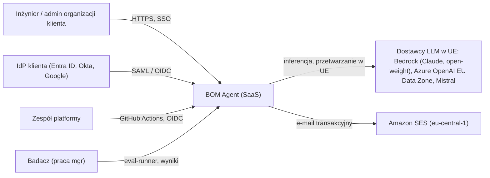
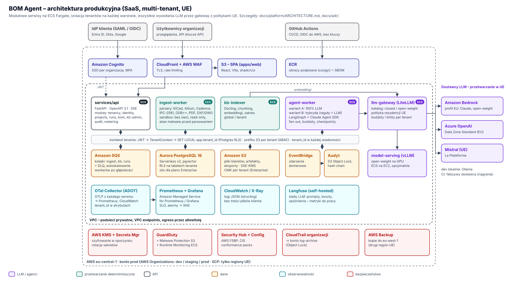
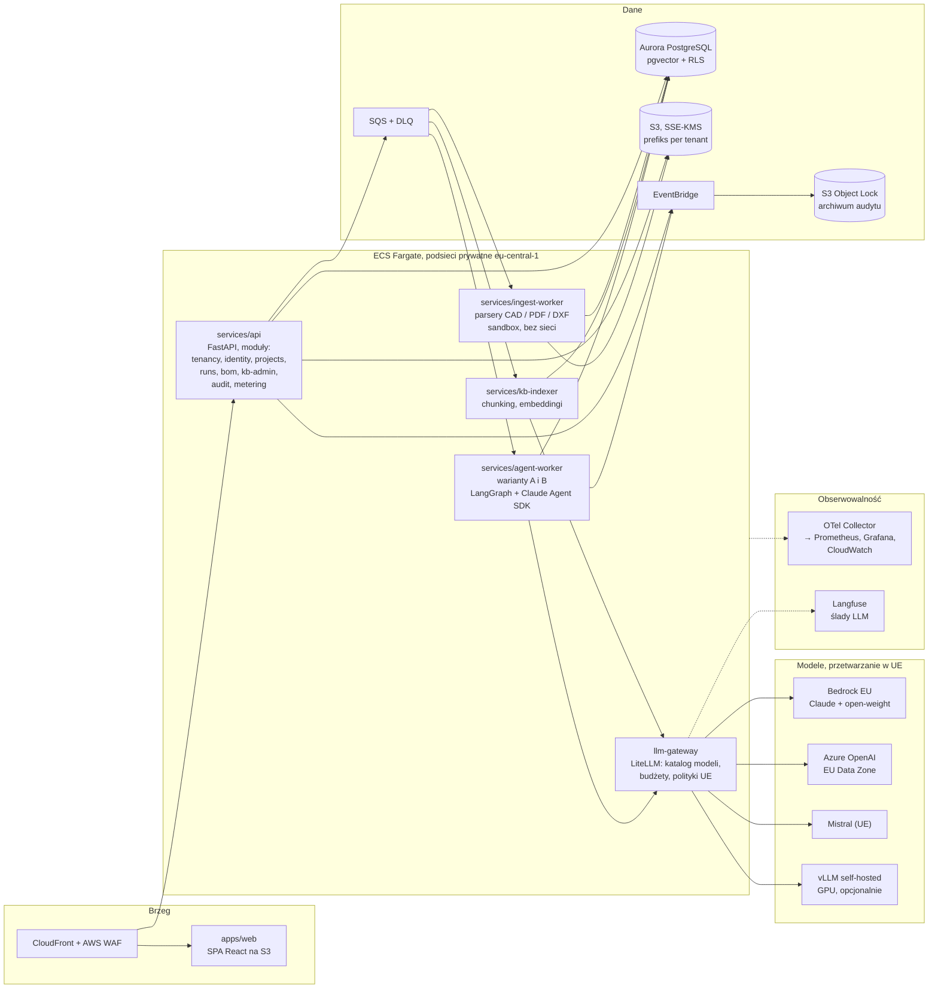

# Architektura platformy BOM Agent (docelowa, produkcyjna)

Status: **zaakceptowana do implementacji** (szczegóły decyzji w `docs/adr/`). Autor rekomendacji: Claude, na podstawie wymagań Bartka (2026-11-09).

## 1. Wymagania, które napędzają architekturę

| # | Wymaganie | Skutek architektoniczny |
|---|---|---|
| R1 | Klienci to zewnętrzne firmy (B2B SaaS), wiele organizacji | multi-tenancy od pierwszego commita, SSO per organizacja, RBAC, onboarding self-service |
| R2 | Dane i przetwarzanie wyłącznie w UE | AWS `eu-central-1`, SCP blokujące regiony spoza UE, dostawcy LLM z gwarancją przetwarzania w UE |
| R3 | Modele zamknięte (najwyższa półka: Anthropic, OpenAI) **i** otwarte (open-weight), z rozróżnieniem w eksperymentach | LLM Gateway z katalogiem modeli i politykami routingu per tenant |
| R4 | Wspólna baza wiedzy, ale izolowane przestrzenie; organizacje nie uczą się od siebie | korpus globalny (publiczny, tylko do odczytu) + przestrzenie per tenant, RLS, brak fine-tuningu na danych klientów |
| R5 | Wszystkie formaty: KiCad, Altium, Cadence (OrCAD/Allegro), PDF, DXF/DWG | wtyczkowa warstwa parserów, izolowany serwis ingestii z ciężkimi zależnościami |
| R6 | Modułowo, nie monolit; mikroserwisy tylko tam, gdzie uzasadnione | 4 serwisy wdrożeniowe + biblioteki domenowe z twardymi granicami (patrz §3) |
| R7 | Szybkie agenty | deterministyczne kroki najpierw, równoległy fan-out, tiering modeli, prompt caching, streaming |
| R8 | Obserwowalność, monitoring, audytowalność | OpenTelemetry wszędzie, śledzenie LLM (Langfuse), niezmienny log audytu |
| R9 | Testy E2E, smoke, wszystko „legit” | piramida testów + testy izolacji tenantów + ewaluacje LLM jako testy regresyjne (patrz `TESTING.md`) |
| R10 | Praca magisterska: porównanie A vs B | warianty jako wymienne „runtime’y” na wspólnym kontrakcie; eksperyment przypinany do wersji modelu, promptów, reguł i snapshotu bazy wiedzy |

## 2. Widok kontekstowy (C4 – poziom 1)



## 3. Widok kontenerów (C4 – poziom 2)



Źródło: `docs/img/platform-architecture.svg` (generator: `tools/platform_arch.py`). Ten sam widok jako Mermaid (edytowalny):



### Dlaczego dokładnie te serwisy (a nie więcej)
| Jednostka wdrożeniowa | Dlaczego osobno |
|---|---|
| `api` | Zwykłe CRUD + orkiestracja żądań. **Modularny serwis**, nie mikroserwisy: moduły domenowe mają twarde granice (import-linter, osobne schematy tabel), ale wspólny proces – bo dzielą transakcje i nie mają różnych profili skalowania. |
| `ingest-worker` | Przetwarza **niezaufane pliki** i ma ciężkie natywne zależności (kicad-cli, konwertery DWG, Docling/OCR). Izolacja bezpieczeństwa + inny profil zasobów. |
| `agent-worker` | Długie zadania (sekundy–minuty), skalowanie po długości kolejki, intensywny ruch do LLM. Inny profil skalowania niż API. |
| `kb-indexer` | Wsadowe embeddingi dużych dokumentów; skalowanie niezależne, nie może blokować przebiegów agentów. |
| `llm-gateway` | Jedno miejsce egzekwowania polityk UE, budżetów per tenant, logowania, fallbacku między dostawcami. Gotowy komponent (LiteLLM), nie piszemy go od zera. |
| `model-serving` | GPU – inna infrastruktura (EC2 GPU, Fargate nie obsługuje GPU). Włączane flagą; domyślnie open-weight przez Bedrock. |

Mikroserwisami **nie** są: reguły walidacji, parsery formatów, logika BOM, eval – to biblioteki (`packages/py/*`) używane przez serwisy. Dzięki temu warianty A i B korzystają z dokładnie tego samego kodu domenowego.

## 4. Układ repozytorium (monorepo)

```
apps/web/                      React + Vite + TanStack Router/Query + Tailwind + shadcn/ui
packages/ts/ui/                design system (komponenty na bazie shadcn/ui, tokeny)
packages/ts/api-client/        klient generowany z OpenAPI
services/api/                  FastAPI, moduły domenowe
services/ingest-worker/
services/agent-worker/
services/kb-indexer/
packages/py/platform-common/   kontekst tenanta, auth, OTel, logowanie, emiter audytu, konfiguracja
packages/py/bom-core/          model domenowy BOM, JSON Schema, normalizacja jednostek, grupowanie
packages/py/cad-parsers/       wtyczki formatów (KiCad, Altium, Cadence, IPC-2581, ODB++, EDIF, PDF, DXF/DWG)
packages/py/rules/             deterministyczne walidatory, wersjonowane pakiety reguł (np. IEC 60601 checklist)
packages/py/kb/                retrieval: hybryda wektor + pełnotekst, reranking, zakresy (global/tenant)
packages/py/llm/               klient do llm-gateway, katalog modeli, structured output
packages/py/agents/            definicje agentów, prompty (wersjonowane), grafy LangGraph wariantów A i B
packages/py/eval/              metryki, porównanie z BOM referencyjnym, raporty do pracy
evals/                         zbiory ewaluacyjne (manifest + sumy kontrolne; pliki duże w Git LFS)
infra/cdk/                     AWS CDK (TypeScript): stacki per warstwa
deploy/compose/                lokalny stos (Postgres+pgvector, emulator S3/SQS, LiteLLM, Langfuse, Grafana LGTM, Ollama)
docs/                          architektura, ADR, design, praca mgr
```

## 5. Multi-tenancy i izolacja (ADR-0004)

Model: **pooled** (wspólna infrastruktura) z izolacją na każdej warstwie; plan **Enterprise** może dostać **silo** (dedykowany klaster Aurora + dedykowany klucz KMS) bez zmian w kodzie – routing połączenia po `tenant_id`.

| Warstwa | Mechanizm |
|---|---|
| Tożsamość | JWT z IdP zawiera `org_id`, `roles`; użytkownik może należeć do wielu organizacji, aktywna organizacja wybierana w UI (przełącznik w lewym górnym rogu) |
| API | zależność FastAPI ustawia `TenantContext`; brak kontekstu = 401/403, nigdy „wszystkie dane” |
| Baza | Postgres **RLS** na każdej tabeli tenanta: `USING (tenant_id = current_setting('app.tenant_id')::uuid)`; `SET LOCAL app.tenant_id` w każdej transakcji; rola aplikacji bez `BYPASSRLS`; migracje osobną rolą |
| Pliki | S3 `s3://…/tenants/{tenant_id}/…`, dostęp przez role z tagami sesji (ABAC) ograniczonymi do prefiksu; SSE-KMS (Enterprise: CMK per tenant) |
| Kolejki/zdarzenia | każda wiadomość niesie `tenant_id`; worker odtwarza kontekst i ustawia RLS przed dostępem do danych |
| Baza wiedzy | patrz §7 |
| LLM | budżety i limity per tenant w gateway; klucze cache’u promptów i pamięci agentów zawierają `tenant_id`; brak treningu na danych klientów |
| Obserwowalność | `tenant_id` jako atrybut zasobu/spanu; logi bez treści plików klienta |
| Testy | zestaw testów „cross-tenant” (próby odczytu/zapisu cudzych danych przez API, SQL, S3, KB) – blokuje merge |

Onboarding organizacji: rejestracja → weryfikacja domeny e-mail → utworzenie tenanta (workflow: rekord, role domyślne, limity planu, opcjonalnie konfiguracja SSO SAML/OIDC, opcjonalnie silo) → zaproszenia członków. Offboarding: eksport danych + kasowanie (RODO), z dowodem w logu audytu.

## 6. Tożsamość i uprawnienia (ADR-0005)
- **Amazon Cognito** (`eu-central-1`) jako broker tożsamości: konta lokalne + federacja **SAML 2.0 / OIDC per organizacja** (Entra ID, Okta, Google Workspace); MFA wymagane dla ról admin.
- Aplikacja zależy wyłącznie od standardu **OIDC** – dostawcę da się zamienić (np. Keycloak) bez zmian w modułach.
- Role: `owner`, `admin`, `engineer`, `reviewer`, `viewer`; uprawnienia jako polityki w kodzie (moduł `authz`, format zgodny z Cedar – możliwa późniejsza migracja do Amazon Verified Permissions).
- Klucze API dla integracji (per organizacja, z zakresem, rotacja, hash w bazie).
- Przyszłe: SCIM 2.0 do provisioningu użytkowników (ADR do napisania przy pierwszym kliencie Enterprise).

## 7. Baza wiedzy (ADR-0008)
- Jeden magazyn: **pgvector w Aurora PostgreSQL** + pełnotekstowe wyszukiwanie Postgresa (hybryda) + reranker.
- **Zakresy (scope):** `global` – publiczne datasheety, utrzymywane przez platformę, dla wszystkich tylko do odczytu; `tenant` – prywatne dokumenty i biblioteki komponentów organizacji, widoczne wyłącznie dla niej (RLS).
- Polityka RLS dla `kb_chunks`: `tenant_id = current_tenant OR scope = 'global'`; zapis do `global` tylko rolą pipeline’u platformy.
- **Brak uczenia między organizacjami:** poprawki użytkowników (np. zmieniony MPN) zapisują się jako wiedza tenanta i są używane tylko w jego przebiegach; żadne dane tenanta nie trafiają do korpusu globalnego ani do fine-tuningu; embeddingi liczone osobno per dokument tenanta.
- Wersjonowanie: każdy przebieg zapisuje `kb_snapshot_id` (dla powtarzalności eksperymentów).

## 8. LLM: modele zamknięte i otwarte (ADR-0006)

**LiteLLM** jako gateway (open source) z katalogiem modeli, w którym każdy model ma atrybuty: `provider`, `license_class` (`closed` | `open-weight`), `residency` (`eu-region` | `eu-geo`), `capabilities`, koszt.

| Klasa | Dostawca | Uwaga o UE |
|---|---|---|
| Zamknięte, najwyższa półka – Anthropic Claude | Amazon Bedrock, profil wnioskowania **EU** (cross-region w obrębie UE) lub in-region, gdzie dostępne | profil „EU” trzyma dane w regionach europejskich; sprawdzić listę regionów docelowych profilu (niektóre profile obejmują Zurych – Szwajcaria, poza UE, ale z decyzją o adekwatności RODO). Do pełnego „tylko UE” użyć profilu aplikacyjnego / in-region. |
| Zamknięte, najwyższa półka – OpenAI | **Azure OpenAI, wdrożenie Data Zone Standard (EU)** w regionie UE (np. Sweden Central) lub OpenAI API z rezydencją EU | nie używać wdrożeń „Global”; batch tylko w wariancie Data Zone |
| Otwarte (open-weight) | Bedrock (modele open-weight dostępne w UE) **lub** self-hosted **vLLM** na GPU w `eu-central-1`; Mistral (firma z UE) | self-hosted = pełna kontrola, wyższy koszt stały; domyślnie Bedrock |
| Lokalnie (dev) | **Ollama** | tylko środowisko deweloperskie |

Zasady: wywołania wyłącznie przez gateway; allowlista endpointów (egress); konfiguracja „no training / zero data retention” tam, gdzie dostawca ją oferuje; dokładne ID modeli w konfiguracji (nie w kodzie) i **weryfikowane przy włączaniu**, bo dostępność modeli w regionach się zmienia.

Eksperyment do pracy: macierz **{wariant A, wariant B} × {model zamknięty, model otwarty}** na tym samym zbiorze – rozróżnienie zamknięte/otwarte to dodatkowy wymiar wyników.

## 9. Runtime agentów i szybkość (ADR-0007)
- **LangGraph** – orkiestracja obu wariantów jako grafów stanu; checkpointy w Postgresie (wznawianie, human-in-the-loop, pełny ślad kroków).
- **Claude Agent SDK** – drugi adapter runtime’u dla wariantu A (agentowa pętla z narzędziami), za wspólnym interfejsem `VariantRuntime`; pozwala porównać „własny graf” z „gotowym agentem”.
- Wspólny kontrakt: wejście `ParsedDesign + Requirements + RunConfig`, wyjście `BomVersion + Trace + Usage`.
- Szybkość:
  1. deterministyczne kroki przed LLM (wariant B rozstrzyga regułami większość pozycji),
  2. równoległy fan-out pozycji BOM (LangGraph `Send` / map-reduce) z limitem współbieżności per tenant,
  3. tiering modeli: szybki model do klasyfikacji i prostych dopasowań, najmocniejszy do trudnych,
  4. prompt caching wspólnych prefiksów, batchowanie zapytań do KB,
  5. structured output (JSON Schema) – brak ponownych prób parsowania,
  6. streaming postępu do UI przez SSE,
  7. budżety: limit czasu, tokenów i iteracji per przebieg.

## 10. Ingestia formatów (ADR-0009, szczegóły: `FORMATS.md`)
Wtyczki `cad-parsers` z jednym interfejsem `parse(file) -> ParsedDesign` i metadanymi „pewności”. Ścieżki: natywne parsery tam, gdzie format jest otwarty (KiCad, DXF, IPC-2581, ODB++, EDIF); dla formatów zamkniętych binarnych – parsery open source po spike’u albo eksporty z narzędzia klienta (to jest uczciwe ograniczenie, opisane w UI). Parsery działają w osobnym zadaniu ECS: bez dostępu do sieci, read-only FS, non-root, limity CPU/RAM/czasu, skan malware (GuardDuty Malware Protection for S3) przed parsowaniem.

## 11. Obserwowalność i audyt (ADR-0010, ADR-0011)
- **OpenTelemetry** (traces, metrics, logs) w każdym serwisie, auto-instrumentacja FastAPI/SQLAlchemy/httpx, konwencje semantyczne GenAI dla wywołań LLM; propagacja kontekstu przez SQS (atrybuty wiadomości).
- Chmura: ADOT Collector → Amazon Managed Service for Prometheus + Amazon Managed Grafana + CloudWatch Logs / X-Ray. Lokalnie: obraz `grafana/otel-lgtm`.
- **Langfuse** (self-hosted w UE) – ślady LLM, koszty, oceny; źródło danych do metryk w pracy.
- SLO: dostępność API, p95 opóźnienia API, odsetek udanych przebiegów, wiek najstarszej wiadomości w kolejce; alarmy → SNS.
- **Audyt:** każda operacja zmieniająca dane emituje `AuditEvent` (kto, tenant, co, kiedy, skąd, przed/po – bez treści plików); zapis do tabeli append-only z łańcuchem skrótów (hash chain) + eksport do S3 z Object Lock (tryb compliance). Każda pozycja BOM ma **pochodzenie**: reguła (z wersją pakietu reguł) albo agent (model, wersja promptu, cytowane fragmenty KB). UI pokazuje to wprost.

## 12. Infrastruktura i środowiska (ADR-0002, ADR-0003, ADR-0013)
- AWS Organizations: konta `management`, `security` (GuardDuty, Security Hub – administrator delegowany), `log-archive` (CloudTrail organizacji, Object Lock), `shared-services` (ECR), `dev`, `staging`, `prod`. SCP: odmowa regionów spoza UE (z wyjątkami dla usług globalnych).
- Region główny `eu-central-1`; kopie zapasowe (AWS Backup) do drugiego regionu UE (`eu-west-1`).
- Compute: **ECS Fargate** (API, workery, gateway, Langfuse), autoskalowanie po CPU/kolejce; **Lambda** tylko do kleju zdarzeń (np. reakcja na upload do S3); **bez Kubernetes** na tym etapie (koszt operacyjny nieuzasadniony – ADR-0003 opisuje, kiedy wrócić do tematu).
- IaC: **AWS CDK (TypeScript)** + `cdk-nag` (reguły AWS Solutions + HIPAA/NIST jako punkt odniesienia).
- Sieć: VPC z podsieciami prywatnymi, VPC endpoints (S3, SQS, Bedrock, Secrets Manager, ECR, Logs, KMS), egress przez NAT z allowlistą domen (Azure OpenAI EU, Mistral).

## 13. CI/CD (ADR-0012)
GitHub Actions, połączenie z AWS przez **OIDC** (bez długoterminowych kluczy), akcje przypięte do SHA.
- PR: lint/typy/granice modułów → testy jednostkowe → integracyjne (Testcontainers) → kontraktowe (Schemathesis na OpenAPI) → testy izolacji tenantów → E2E Playwright na lokalnym stosie z fałszywym dostawcą LLM → skany (CodeQL, Trivy, gitleaks, zależności) → `cdk synth` + cdk-nag.
- `main`: budowa obrazów, SBOM (Syft), podpis (cosign) → dev → smoke → staging → smoke + E2E → ręczne zatwierdzenie → prod (rolling z circuit breakerem) → smoke prod.
- Joby wdrożeniowe wyłączone, dopóki `vars.AWS_DEPLOY_ENABLED != 'true'` (konto AWS jeszcze nie skonfigurowane).

## 14. Co jest poza zakresem v1 (świadomie)
SCIM, rozliczenia płatnicze (jest tylko metering zużycia), multi-region active-active, marketplace integracji (dystrybutorzy komponentów, PLM), podpis elektroniczny zgodny z 21 CFR Part 11.
