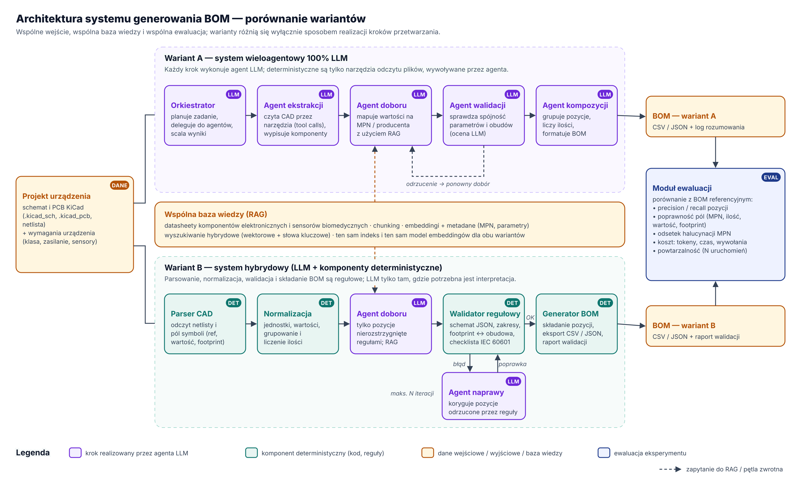

# Architektura systemu



Źródło diagramu: `docs/img/architektura.svg` (generowany skryptem `tools/arch.py`). Wersja do podglądu w przeglądarce: [`architektura.html`](architektura.html).

## Zasada porównania
Oba warianty mają **to samo wejście** (projekt KiCad + wymagania urządzenia), **tę samą bazę wiedzy RAG**, **ten sam model LLM** i **ten sam moduł ewaluacji**. Zmienia się tylko to, kto wykonuje poszczególne kroki – dzięki temu różnice w wynikach można przypisać architekturze.

| Krok | Wariant A – 100% LLM | Wariant B – hybrydowy |
|---|---|---|
| Odczyt projektu CAD | agent ekstrakcji wywołuje narzędzia CAD | parser deterministyczny |
| Normalizacja i grupowanie | agent LLM | reguły (jednostki, wartości, ilości) |
| Dobór MPN | agent doboru + RAG, wszystkie pozycje | reguły; agent doboru + RAG tylko dla pozycji nierozstrzygniętych |
| Walidacja | agent walidacji (ocena LLM) | walidator regułowy: JSON Schema, zakresy parametrów, footprint ↔ obudowa, checklista IEC 60601; przy błędzie agent naprawy (maks. N iteracji) |
| Składanie i eksport BOM | agent kompozycji | generator deterministyczny (CSV/JSON + raport) |

## Moduły (proponowany układ repozytorium kodu)
```
src/
  cad/          parser KiCad + narzędzia dla agentów (function calling / MCP)
  kb/           ingest datasheetów, chunking, embeddingi, wyszukiwanie hybrydowe
  agents/       profile i prompty agentów (wspólne dla A i B)
  variant_a/    orkiestracja 100% LLM
  variant_b/    potok hybrydowy: normalizacja, reguły walidacji, generator BOM
  eval/         porównanie z BOM referencyjnym, metryki, raporty
  schema/       JSON Schema pozycji BOM
data/
  projects/     otwarte projekty KiCad
  reference/    BOM referencyjne
  datasheets/   dokumentacja komponentów
ui/             prototyp interfejsu
```

## Metryki ewaluacji
- precision / recall / F1 pozycji BOM
- dokładność pól: MPN, producent, wartość, footprint, ilość
- odsetek halucynacji MPN
- skuteczność walidacji (na błędach wstrzykniętych)
- koszt: tokeny, wywołania LLM, czas
- powtarzalność: rozrzut wyników w N uruchomieniach
